<div align="center">

# 🛡 SOCBench

### Web-Based SOC Analyst Attack Simulation Lab

*Generate realistic attack traffic in your lab. Capture it. Analyse it. Build better detections.*

[](https://www.python.org/)
[](https://flask.palletsprojects.com/)
[](https://scapy.net/)
[](LICENSE)
[](https://www.kali.org/)

> **For authorized lab and training environments only.**  
> Do not use against any network you do not own or have explicit written permission to test.

</div>

---

## What is SOCBench

SOCBench is a **web-based SOC analyst training platform** that lets you simulate 35+ real-world network attacks against lab targets, capture the traffic automatically as PCAP files, and get the exact Wireshark filter to analyse each attack — all from a clean browser UI.

Built for:
- **SOC analysts** learning to recognise attack signatures in Wireshark
- **Security trainers** running controlled lab exercises
- **Blue teams** building IDS rules and detection playbooks
- **Students** studying for certifications (CEH, OSCP, CompTIA CySA+, etc.)

---

## Screenshots

### Dashboard

| Main Interface | Device Discovery |
|---|---|
| 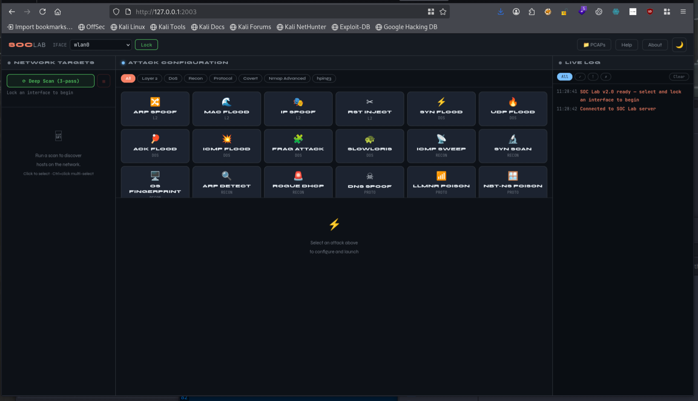 | 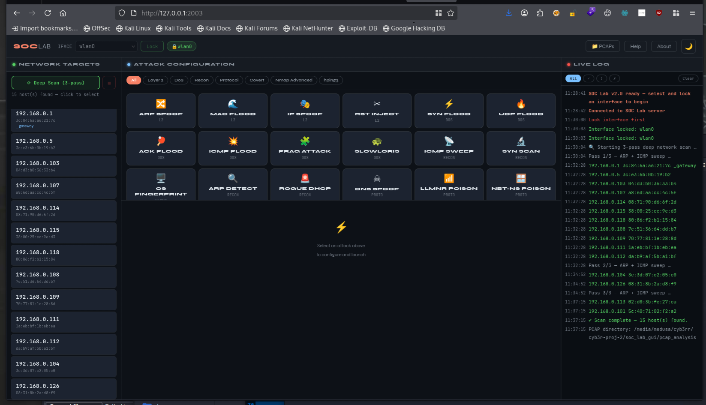 |

| Dark Mode | Saved PCAPs |
|---|---|
| 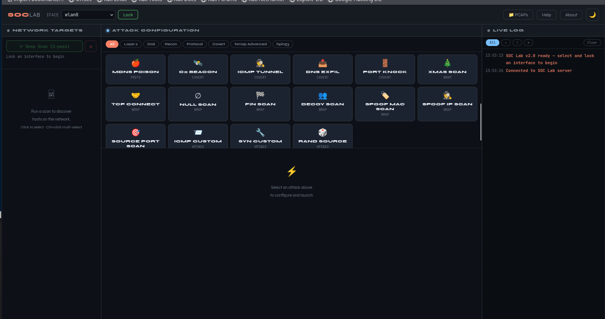 | 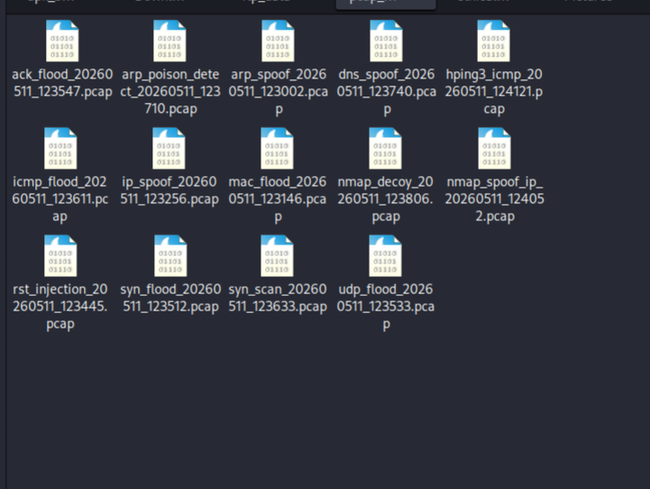 |

---

### Attack Simulations in Action

| ARP Spoofing | ARP Poison Detect |
|---|---|
| 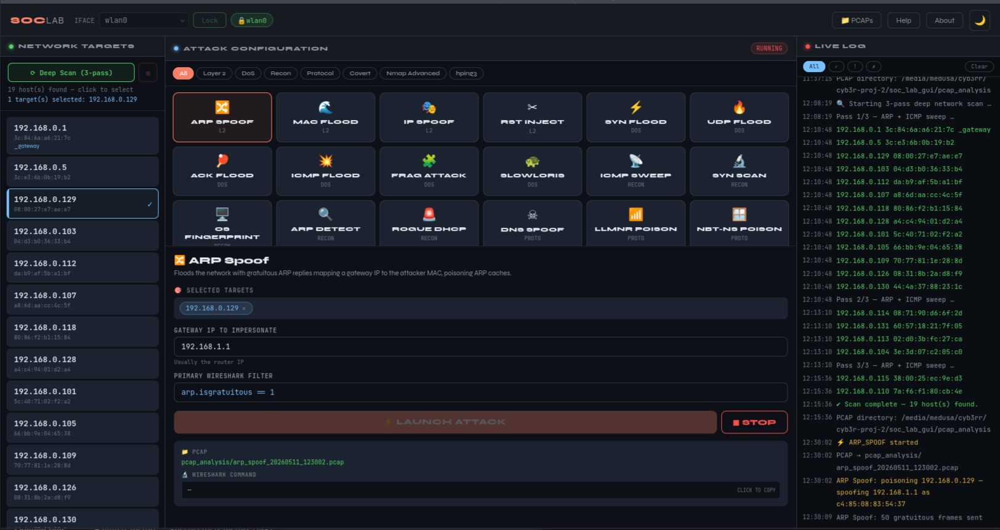 | 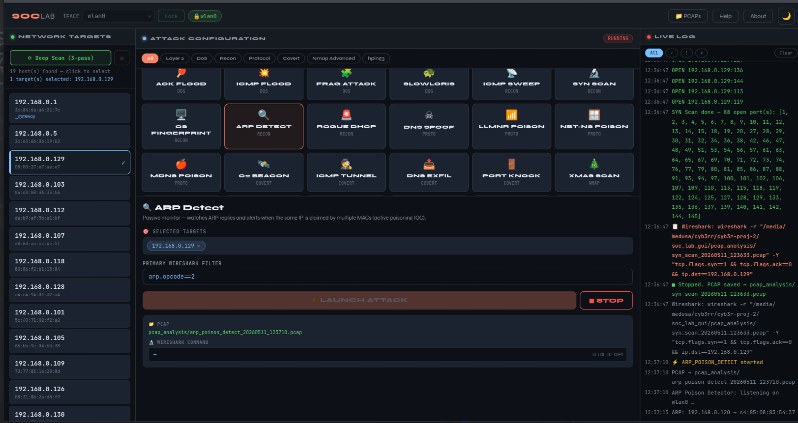 |

| MAC Flood | IP Spoofing |
|---|---|
| 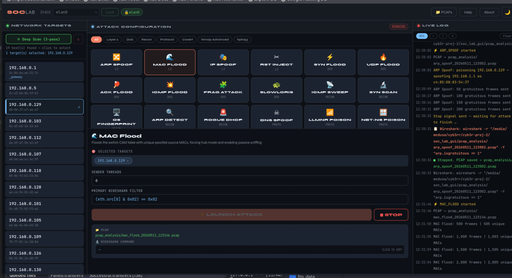 | 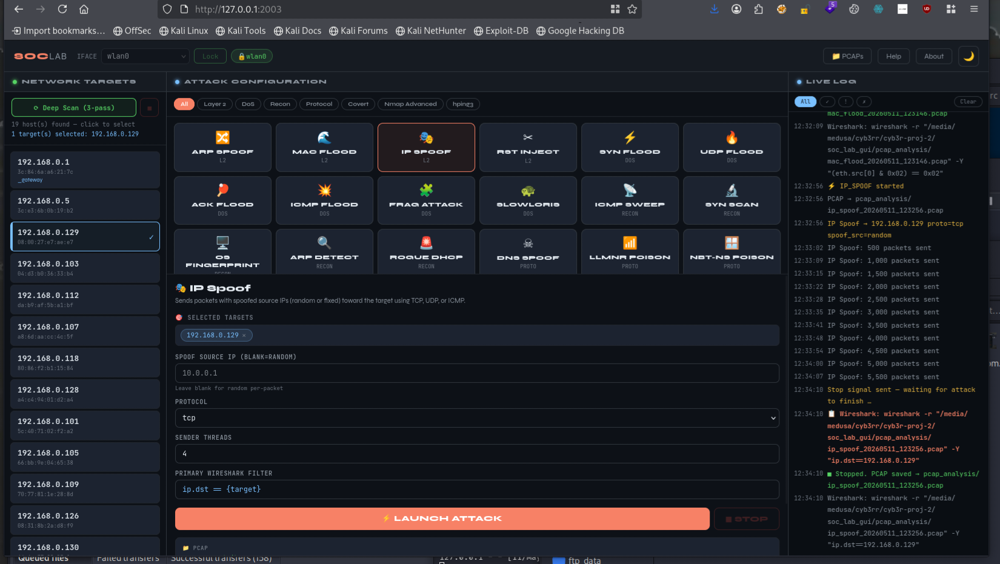 |

| SYN Flood | UDP Flood |
|---|---|
| 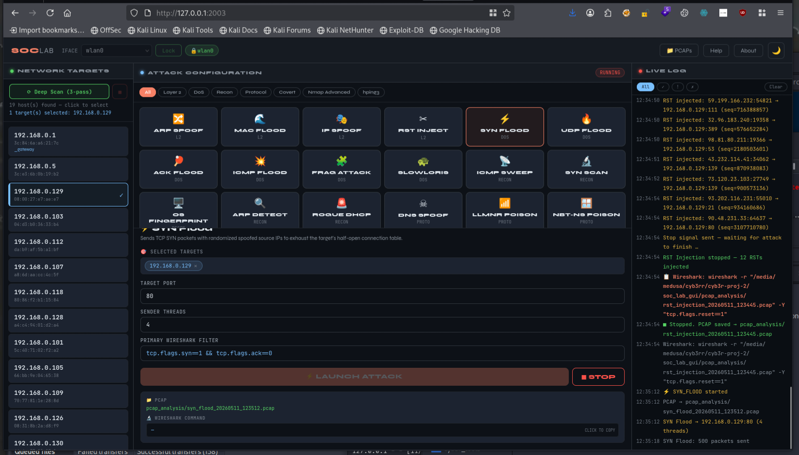 | 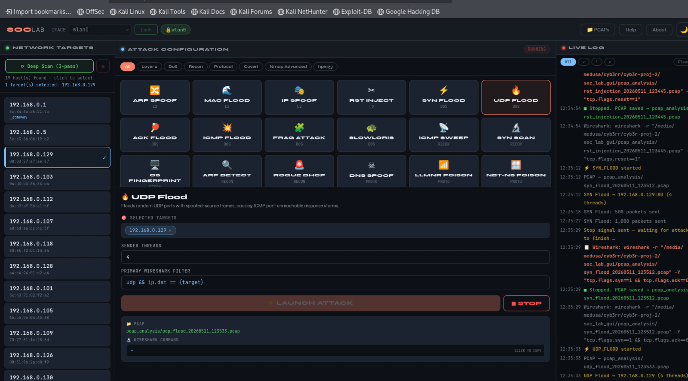 |

| ACK Flood | ICMP Flood |
|---|---|
| 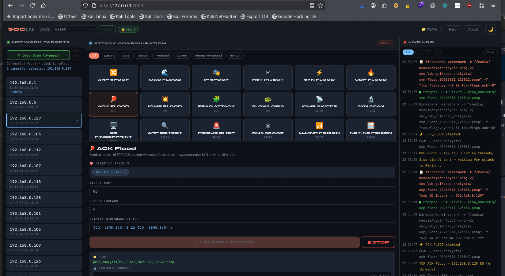 | 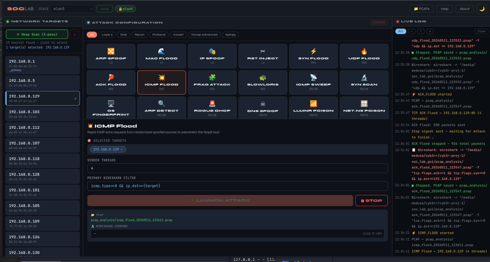 |

| RST Injection | DNS Spoofing |
|---|---|
| 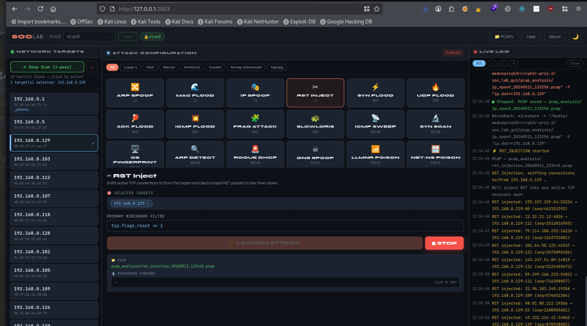 | 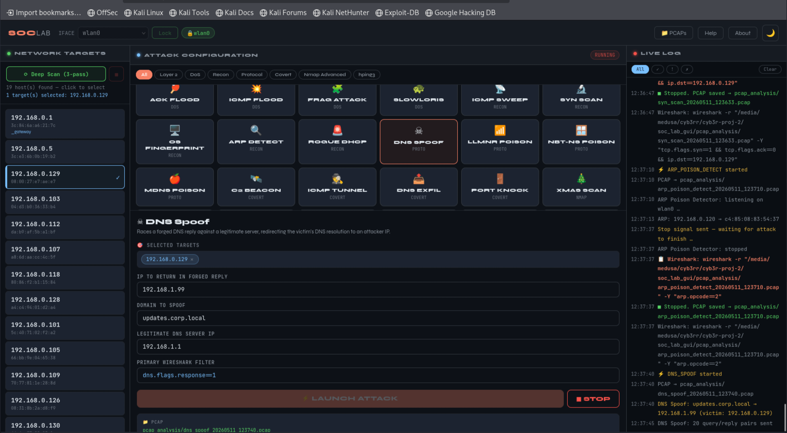 |

| Nmap Decoy Scan | Nmap SYN Scan |
|---|---|
| 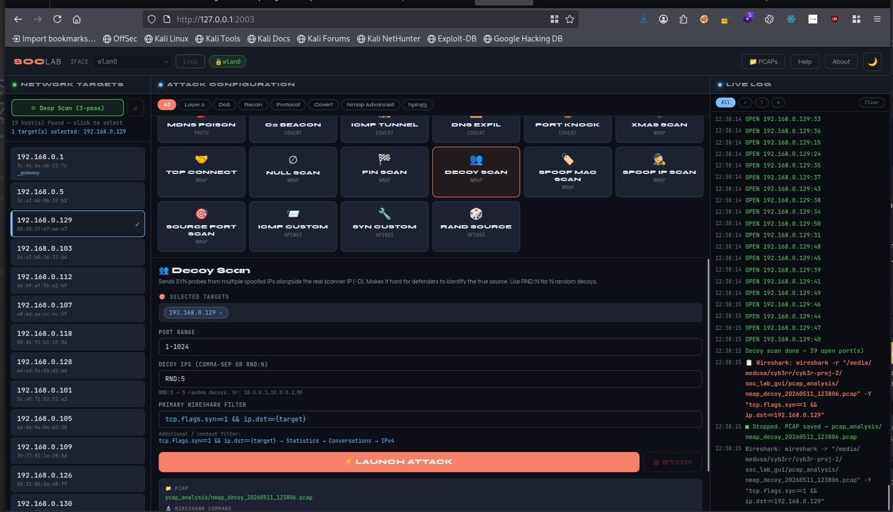 | 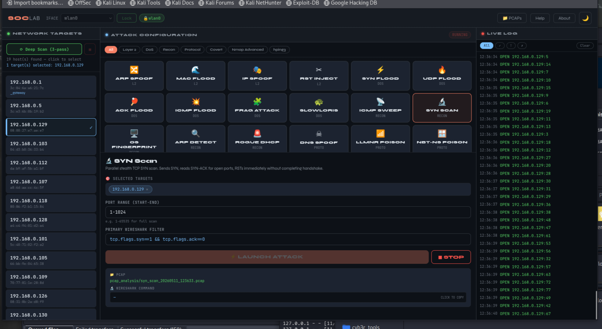 |

| Nmap Spoof IP Scan | hping3 ICMP Custom |
|---|---|
| 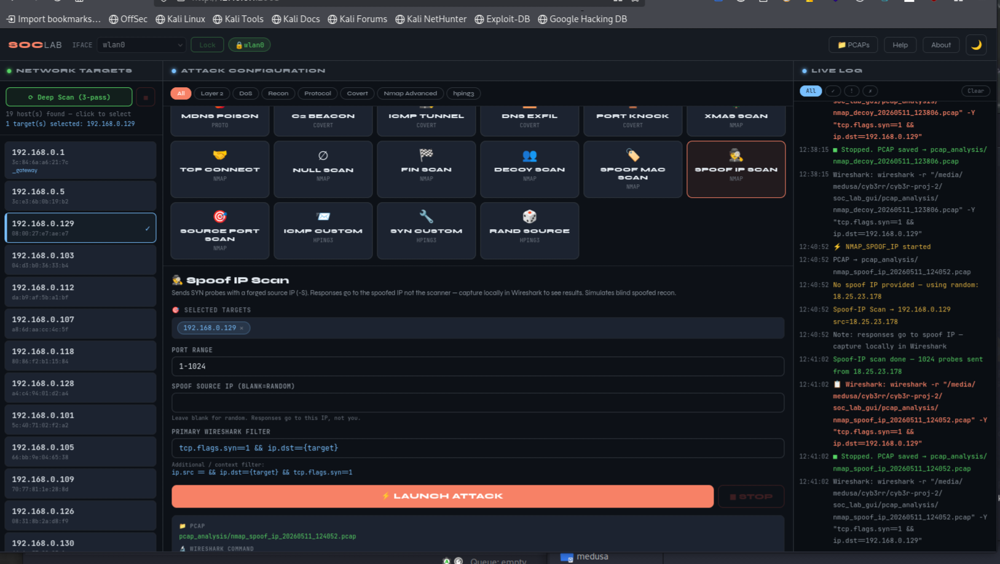 | 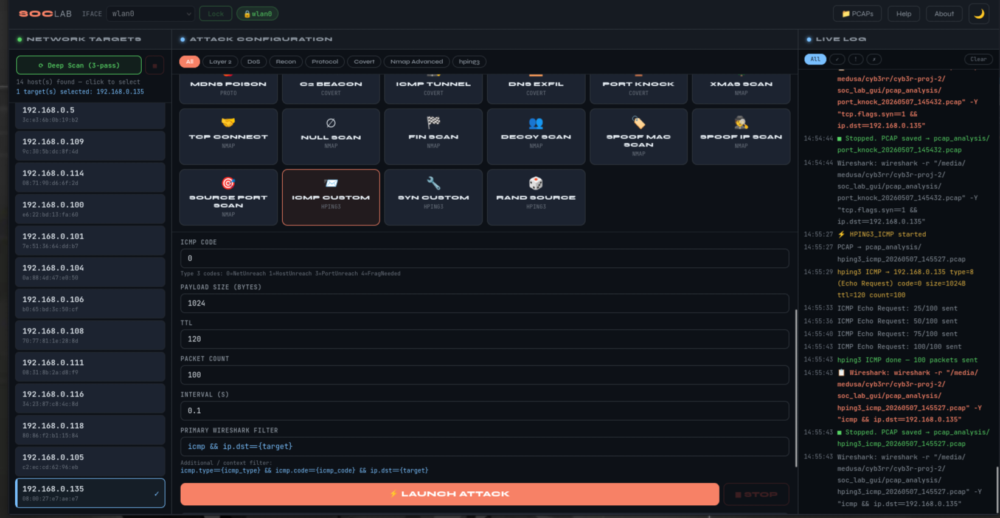 |

---

## Features

- **35+ attack simulations** across 7 categories, all runnable from the browser
- **3-pass deep network scan** (ARP + ICMP) discovers all hosts on the segment
- **Multi-target selection** — Ctrl+click to select multiple hosts, run attacks against all
- **Auto PCAP capture** saved to `pcap_analysis/attackname_YYYYMMDD_HHMMSS.pcap`
- **One-click Wireshark command** shown after every attack — primary filter + context hints
- **Live log stream** via WebSocket — filterable by level (info / success / warn / error)
- **Dark & light mode** with localStorage persistence
- **Interface lock** — choose once at startup, restart to change

---

## Attack Coverage

### 🔵 Layer 2 / LAN
| Attack | Description | Wireshark Filter |
|---|---|---|
| ARP Spoofing | Gratuitous ARP cache poisoning flood | `arp.isgratuitous == 1` |
| MAC Flood | CAM table overflow → hub mode | `(eth.src[0] & 0x02) == 0x02` |
| IP Spoofing | Spoofed-source TCP/UDP/ICMP flood | `ip.dst == <target>` |
| RST Injection | Sniffs live TCP sessions, forges RST to tear them down | `tcp.flags.reset == 1` |

### 🔴 Denial of Service
| Attack | Description | Wireshark Filter |
|---|---|---|
| SYN Flood | Half-open connection table exhaustion | `tcp.flags.syn==1 && tcp.flags.ack==0` |
| UDP Flood | Random-port saturation + ICMP storm | `udp && ip.dst==<target>` |
| ACK Flood | Spoofed ACK storm bypassing SYN limiters | `tcp.flags.ack==1 && tcp.flags.syn==0` |
| ICMP Flood | Echo request flood with spoofed sources | `icmp.type==8 && ip.dst==<target>` |
| Fragmentation Attack | Overlapping IP fragments — stresses IDS reassembly | `ip.flags.mf==1 \|\| ip.frag_offset>0` |
| Slowloris | Partial HTTP connections exhaust server pool | `tcp.dstport==<port> && ip.dst==<target>` |

### 🟡 Reconnaissance
| Attack | Description | Wireshark Filter |
|---|---|---|
| ICMP Sweep | Parallel L2 ping sweep with OS TTL hints | `icmp.type==8 \|\| icmp.type==0` |
| SYN Scan | Parallel stealth half-open port scan | `tcp.flags.syn==1 && tcp.flags.ack==0` |
| OS Fingerprinting | NULL / FIN / XMAS / ACK probes → OS detection | `tcp.flags==0x000 \|\| tcp.flags==0x029` |
| ARP Poison Detect | Passive — alerts on IP→MAC conflicts | `arp.opcode==2` |
| Rogue DHCP Detect | Passive — flags unauthorized DHCP servers | `dhcp.option.dhcp==2` |

### 🟠 Protocol Abuse
| Attack | Description | Wireshark Filter |
|---|---|---|
| DNS Spoofing | Forged DNS reply race against real server | `dns.flags.response==1` |
| LLMNR Poisoning | Forged LLMNR responses (Responder-style) | `udp.port==5355` |
| NBT-NS Poisoning | Forged NetBIOS Name Service responses | `udp.port==137` |
| mDNS Poisoning | Forged .local multicast DNS responses | `udp.port==5353` |

### 🟣 Covert Channels
| Attack | Description | Wireshark Filter |
|---|---|---|
| C2 Beaconing | Periodic SYN+data+FIN check-in with jitter | `tcp.flags.syn==1 && ip.dst==<target>` |
| ICMP Covert Channel | Text encoded in ICMP echo payloads | `icmp.type==8 && data.len>8` |
| DNS Exfiltration | Base32 data encoded as DNS subdomain labels | `dns.flags.response==0` |
| Port Knocking | Sequential SYN probe sequence | `tcp.flags.syn==1 && ip.dst==<target>` |

### 🟢 Nmap Advanced
| Attack | nmap Flag | Wireshark Filter |
|---|---|---|
| Xmas Scan | `-sX` | `tcp.flags==0x029` |
| TCP Connect Scan | `-sT` | `tcp && ip.dst==<target>` |
| NULL Scan | `-sN` | `tcp.flags==0x000` |
| FIN Scan | `-sF` | `tcp.flags==0x001` |
| Decoy Scan | `-D RND:N` | Statistics → Conversations → IPv4 |
| Spoof MAC Scan | `--spoof-mac` | `(eth.src[0] & 0x02)==0x02` |
| Spoof IP Scan | `-S <ip>` | `ip.src==<spoof> && tcp.flags.syn==1` |
| Source Port Scan | `-g 53` | `tcp.srcport==53 && ip.dst==<target>` |

> Nmap modules use the native `nmap` binary when available and **fall back to a full Scapy implementation** automatically.

### 🔵 hping3 Advanced
| Attack | Description | Wireshark Filter |
|---|---|---|
| ICMP Custom | Full control over type, code, payload, TTL, ID | `icmp.type==N && icmp.code==N` |
| SYN Custom | Full control over flags, window, TTL, seq, options | `tcp.window_size_value==N && ip.ttl==N` |
| Random Source | Per-packet randomized source IP (TCP/UDP/ICMP) | Statistics → Conversations → IPv4 |

---

## Project Structure

```
NetSentinel/
├── app.py                       # Flask + SocketIO server (entry point)
├── requirements.txt
├── README.md
├── images/                      # Screenshots
├── templates/
│   └── index.html               # Single-page UI (dark/light mode, WebSocket)
└── attacks/
    ├── base.py                  # BaseAttack — all modules inherit this
    ├── scanner.py               # 3-pass ARP + ICMP host discovery
    │
    ├── arp_spoof.py             # Layer 2
    ├── mac_flood.py
    ├── ip_spoof.py
    ├── rst_injection.py
    │
    ├── syn_flood.py             # DoS
    ├── udp_flood.py
    ├── ack_flood.py
    ├── icmp_flood.py
    ├── frag_attack.py
    ├── slowloris.py
    │
    ├── icmp_sweep.py            # Recon
    ├── syn_scan.py
    ├── os_fingerprint.py
    ├── arp_poison_detect.py
    ├── rogue_dhcp_detect.py
    │
    ├── dns_spoof.py             # Protocol Abuse
    ├── llmnr_poison.py
    ├── nbtns_poison.py
    ├── mdns_poison.py
    │
    ├── c2_beacon.py             # Covert
    ├── icmp_tunnel.py
    ├── dns_exfil.py
    ├── port_knock.py
    │
    ├── nmap_xmas.py             # Nmap Advanced
    ├── nmap_tcp.py
    ├── nmap_null.py
    ├── nmap_fin.py
    ├── nmap_decoy.py
    ├── nmap_spoof_mac.py
    ├── nmap_spoof_ip.py
    ├── nmap_source_port.py
    │
    ├── hping3_icmp.py           # hping3 Advanced
    ├── hping3_syn.py
    └── hping3_rand_source.py
```

---

## Setup & Installation

### Requirements
- Linux (Kali, Ubuntu, Debian) — raw socket access required
- Python 3.10+
- `nmap` (optional — Nmap modules fall back to Scapy if absent)

### 1 — Install system dependencies

```bash
sudo apt update
sudo apt install python3 python3-pip python3-venv \
                 wireshark libpcap-dev nmap -y

# Allow your user to open PCAP files in Wireshark without sudo
sudo usermod -aG wireshark $USER
```

### 2 — Clone and set up

```bash
git clone https://github.com/1024Cyber/SOCBench.git
cd NetSentinel

python3 -m venv venv
source venv/bin/activate

pip install -r requirements.txt
```

### 3 — Run

```bash
# Raw socket access requires root
sudo venv/bin/python3 app.py
```

### 4 — Open in browser

```
http://127.0.0.1:5000
```

---

## How to Use

```
1. Select interface  →  Choose wlan0 / eth0 from the top bar, click Lock
2. Scan network      →  Click "Deep Scan (3-pass)" — hosts appear on the left
3. Select targets    →  Click a host (Ctrl+click for multi-select)
4. Choose attack     →  Pick from the attack grid, filter by category
5. Configure         →  Fill in parameters — Wireshark filter shown in preview
6. Launch            →  Click "Launch Attack"  (greyed until target is loaded)
7. Stop              →  Click "Stop Attack"
8. Analyse           →  Copy the Wireshark command shown — PCAP auto-saved to pcap_analysis/
```

### PCAP files

All captures are saved automatically:

```
pcap_analysis/
├── syn_flood_20250525_143201.pcap
├── arp_spoof_20250525_143518.pcap
└── nmap_xmas_20250525_144002.pcap
```

Open any capture directly:

```bash
# With pre-applied Wireshark display filter
wireshark -r pcap_analysis/syn_flood_20250525_143201.pcap \
          -Y "tcp.flags.syn==1 && tcp.flags.ack==0"
```

---

## Wireshark Quick Reference

| Category | Attack | Display Filter |
|---|---|---|
| L2 | ARP Spoof | `arp.isgratuitous == 1` |
| L2 | MAC Flood | `(eth.src[0] & 0x02) == 0x02` |
| L2 | RST Inject | `tcp.flags.reset == 1` |
| DoS | SYN Flood | `tcp.flags.syn==1 && tcp.flags.ack==0` |
| DoS | UDP Flood | `udp && ip.dst == <target>` |
| DoS | Frag Attack | `ip.flags.mf==1 \|\| ip.frag_offset>0` |
| Recon | ICMP Sweep | `icmp.type==8 \|\| icmp.type==0` |
| Recon | OS Fingerprint | `tcp.flags==0x000 \|\| tcp.flags==0x029` |
| Protocol | DNS Spoof | `dns.flags.response==1` |
| Protocol | LLMNR Poison | `udp.port==5355` |
| Covert | ICMP Tunnel | `icmp.type==8 && data.len>8` |
| Covert | DNS Exfil | `dns.flags.response==0 && dns.qry.name contains "<domain>"` |
| Nmap | Xmas Scan | `tcp.flags==0x029` |
| Nmap | NULL Scan | `tcp.flags==0x000` |
| Nmap | FIN Scan | `tcp.flags==0x001` |
| Nmap | Decoy Scan | Statistics → Conversations → IPv4 |
| hping3 | ICMP Custom | `icmp.type==N && icmp.code==N && ip.dst==<target>` |
| hping3 | SYN Custom | `tcp.window_size_value==N && ip.ttl==N` |

---

## Troubleshooting

**Launch button is greyed out**
- Make sure the interface is locked (click Lock in the top bar)
- Make sure at least one host is selected from the target list
- Make sure no scan is currently running

**No hosts found after scan**
- Verify the correct interface is selected
- Test basic connectivity: `ping -c1 192.168.1.1`
- Some hosts block ICMP — ARP scan is more reliable on local LAN

**Permission error on startup**
```bash
# Always run with sudo
sudo venv/bin/python3 app.py
```

**Port 5000 already in use**
```bash
# Edit the last line of app.py
sio.run(app, host="127.0.0.1", port=5001, debug=False, use_reloader=False)
```

**Scapy can't find libpcap**
```bash
sudo apt install libpcap-dev
pip install --upgrade scapy
```

---

## Stack

| Component | Technology |
|---|---|
| Backend | Python 3, Flask, Flask-SocketIO |
| Packet engine | Scapy |
| Real-time comms | WebSocket (Socket.IO) |
| Frontend | Vanilla JS, CSS custom properties |
| Capture format | libpcap `.pcap` |
| Analysis | Wireshark |

---

## ⚠ Disclaimer

NetSentinel is designed exclusively for **authorized lab environments, controlled training exercises, and educational purposes**.

- Do not use against networks you do not own
- Do not use without explicit written permission from the network owner
- The authors accept no liability for misuse

---

## License

MIT License — see [LICENSE](LICENSE) for details.

---

<div align="center">

Made for the blue team. Built to think like the red team.

For access to the complete source-code of this project, reach out to me on Telegram:
t.me/CyberSenal_bot

</div>
